## Event Model: Customer

> **Given** Customer
> **When** CloseAccount, ReactivateAccount, SuspendAccount, AddAddress, RemoveAddress, SetDefaultAddress, UpdateAddress, UpdateProfile, RegisterCustomer, UpgradeTier
> **Then** AccountClosed, AccountReactivated, AccountSuspended, AddressAdded, AddressRemoved, AddressUpdated, CustomerRegistered, DefaultAddressChanged, ProfileUpdated, TierUpgraded

```mermaid
flowchart LR
    subgraph identity_customer_customer_Customer[Customer]
        cmd_identity_customer_account_CloseAccount[/CloseAccount/]
        cmd_identity_customer_account_ReactivateAccount[/ReactivateAccount/]
        cmd_identity_customer_account_SuspendAccount[/SuspendAccount/]
        cmd_identity_customer_addresses_AddAddress[/AddAddress/]
        cmd_identity_customer_addresses_RemoveAddress[/RemoveAddress/]
        cmd_identity_customer_addresses_SetDefaultAddress[/SetDefaultAddress/]
        cmd_identity_customer_addresses_UpdateAddress[/UpdateAddress/]
        cmd_identity_customer_profile_UpdateProfile[/UpdateProfile/]
        cmd_identity_customer_registration_RegisterCustomer[/RegisterCustomer/]
        cmd_identity_customer_tier_UpgradeTier[/UpgradeTier/]
        agg_identity_customer_customer_Customer[Customer]
        evt_identity_customer_events_AccountClosed([AccountClosed])
        evt_identity_customer_events_AccountReactivated([AccountReactivated])
        evt_identity_customer_events_AccountSuspended([AccountSuspended])
        evt_identity_customer_events_AddressAdded([AddressAdded])
        evt_identity_customer_events_AddressRemoved([AddressRemoved])
        evt_identity_customer_events_AddressUpdated([AddressUpdated])
        evt_identity_customer_events_CustomerRegistered([CustomerRegistered])
        evt_identity_customer_events_DefaultAddressChanged([DefaultAddressChanged])
        evt_identity_customer_events_ProfileUpdated([ProfileUpdated])
        evt_identity_customer_events_TierUpgraded([TierUpgraded])
        rm_identity_customer_customer_Customer_identity_projections_address_book_AddressBookProjector[(AddressBookProjector → AddressBook)]
        rm_identity_customer_customer_Customer_identity_projections_customer_card_CustomerCardProjector[(CustomerCardProjector → CustomerCard)]
        rm_identity_customer_customer_Customer_identity_projections_customer_lookup_CustomerLookupProjector[(CustomerLookupProjector → CustomerLookup)]
        rm_identity_customer_customer_Customer_identity_projections_customer_segments_CustomerSegmentsProjector[(CustomerSegmentsProjector → CustomerSegments)]
    end
    cmd_identity_customer_account_CloseAccount --> agg_identity_customer_customer_Customer
    cmd_identity_customer_account_ReactivateAccount --> agg_identity_customer_customer_Customer
    cmd_identity_customer_account_SuspendAccount --> agg_identity_customer_customer_Customer
    cmd_identity_customer_addresses_AddAddress --> agg_identity_customer_customer_Customer
    cmd_identity_customer_addresses_RemoveAddress --> agg_identity_customer_customer_Customer
    cmd_identity_customer_addresses_SetDefaultAddress --> agg_identity_customer_customer_Customer
    cmd_identity_customer_addresses_UpdateAddress --> agg_identity_customer_customer_Customer
    cmd_identity_customer_profile_UpdateProfile --> agg_identity_customer_customer_Customer
    cmd_identity_customer_registration_RegisterCustomer --> agg_identity_customer_customer_Customer
    cmd_identity_customer_tier_UpgradeTier --> agg_identity_customer_customer_Customer
    agg_identity_customer_customer_Customer --> evt_identity_customer_events_AccountClosed
    evt_identity_customer_events_AccountClosed --> rm_identity_customer_customer_Customer_identity_projections_customer_card_CustomerCardProjector
    agg_identity_customer_customer_Customer --> evt_identity_customer_events_AccountReactivated
    evt_identity_customer_events_AccountReactivated --> rm_identity_customer_customer_Customer_identity_projections_customer_card_CustomerCardProjector
    agg_identity_customer_customer_Customer --> evt_identity_customer_events_AccountSuspended
    evt_identity_customer_events_AccountSuspended --> rm_identity_customer_customer_Customer_identity_projections_customer_card_CustomerCardProjector
    agg_identity_customer_customer_Customer --> evt_identity_customer_events_AddressAdded
    evt_identity_customer_events_AddressAdded --> rm_identity_customer_customer_Customer_identity_projections_address_book_AddressBookProjector
    agg_identity_customer_customer_Customer --> evt_identity_customer_events_AddressRemoved
    evt_identity_customer_events_AddressRemoved --> rm_identity_customer_customer_Customer_identity_projections_address_book_AddressBookProjector
    agg_identity_customer_customer_Customer --> evt_identity_customer_events_AddressUpdated
    evt_identity_customer_events_AddressUpdated --> rm_identity_customer_customer_Customer_identity_projections_address_book_AddressBookProjector
    agg_identity_customer_customer_Customer --> evt_identity_customer_events_CustomerRegistered
    evt_identity_customer_events_CustomerRegistered --> rm_identity_customer_customer_Customer_identity_projections_customer_card_CustomerCardProjector
    evt_identity_customer_events_CustomerRegistered --> rm_identity_customer_customer_Customer_identity_projections_customer_lookup_CustomerLookupProjector
    evt_identity_customer_events_CustomerRegistered --> rm_identity_customer_customer_Customer_identity_projections_customer_segments_CustomerSegmentsProjector
    agg_identity_customer_customer_Customer --> evt_identity_customer_events_DefaultAddressChanged
    evt_identity_customer_events_DefaultAddressChanged --> rm_identity_customer_customer_Customer_identity_projections_address_book_AddressBookProjector
    agg_identity_customer_customer_Customer --> evt_identity_customer_events_ProfileUpdated
    evt_identity_customer_events_ProfileUpdated --> rm_identity_customer_customer_Customer_identity_projections_customer_card_CustomerCardProjector
    evt_identity_customer_events_ProfileUpdated --> rm_identity_customer_customer_Customer_identity_projections_customer_segments_CustomerSegmentsProjector
    agg_identity_customer_customer_Customer --> evt_identity_customer_events_TierUpgraded
    evt_identity_customer_events_TierUpgraded --> rm_identity_customer_customer_Customer_identity_projections_customer_card_CustomerCardProjector
    evt_identity_customer_events_TierUpgraded --> rm_identity_customer_customer_Customer_identity_projections_customer_segments_CustomerSegmentsProjector
```

