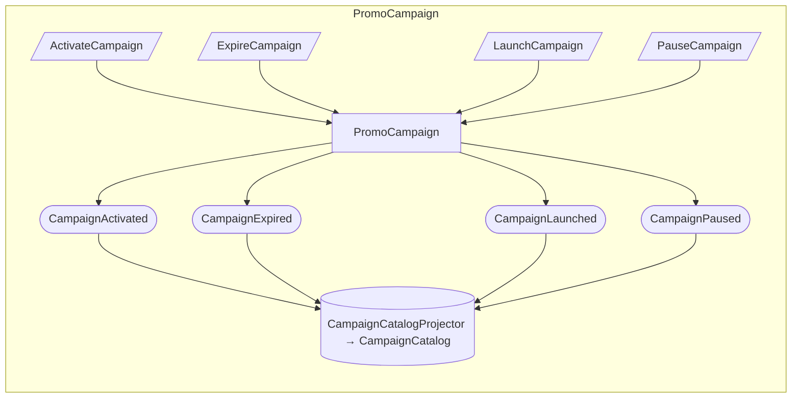
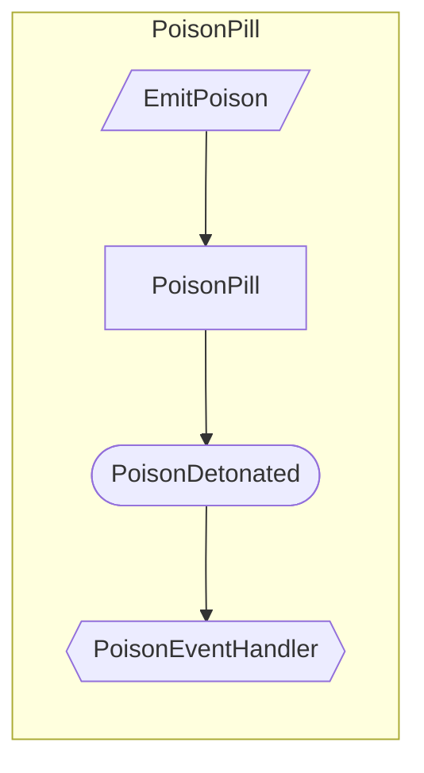
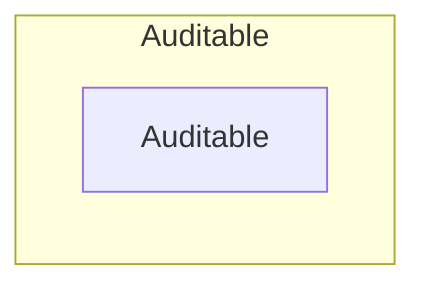

```mermaid
flowchart LR
    subgraph loyalty_reward_reward_account_RewardAccount[RewardAccount]
        cmd_loyalty_reward_enrollment_EnrollRewardAccount[/EnrollRewardAccount/]
        cmd_loyalty_reward_points_EarnPoints[/EarnPoints/]
        cmd_loyalty_reward_points_RedeemPoints[/RedeemPoints/]
        agg_loyalty_reward_reward_account_RewardAccount[RewardAccount]
        evt_loyalty_reward_events_MembershipCardIssued([MembershipCardIssued])
        evt_loyalty_reward_events_MembershipCardIssuedV2([MembershipCardIssuedV2])
        evt_loyalty_reward_events_PointsEarned([PointsEarned])
        evt_loyalty_reward_events_PointsRedeemed([PointsRedeemed])
        evt_loyalty_reward_events_RewardAccountClosed([RewardAccountClosed])
        evt_loyalty_reward_events_RewardAccountEnrolled([RewardAccountEnrolled])
        evt_loyalty_reward_events_TierUpgraded([TierUpgraded])
        rm_loyalty_reward_reward_account_RewardAccount_loyalty_projections_points_leaderboard_PointsLeaderboardProjector[(PointsLeaderboardProjector → PointsLeaderboard)]
        rm_loyalty_reward_reward_account_RewardAccount_loyalty_projections_reward_account_view_RewardAccountViewProjector[(RewardAccountViewProjector → RewardAccountView)]
    end
    cmd_loyalty_reward_enrollment_EnrollRewardAccount --> agg_loyalty_reward_reward_account_RewardAccount
    cmd_loyalty_reward_points_EarnPoints --> agg_loyalty_reward_reward_account_RewardAccount
    cmd_loyalty_reward_points_RedeemPoints --> agg_loyalty_reward_reward_account_RewardAccount
    agg_loyalty_reward_reward_account_RewardAccount --> evt_loyalty_reward_events_MembershipCardIssued
    agg_loyalty_reward_reward_account_RewardAccount --> evt_loyalty_reward_events_MembershipCardIssuedV2
    agg_loyalty_reward_reward_account_RewardAccount --> evt_loyalty_reward_events_PointsEarned
    evt_loyalty_reward_events_PointsEarned --> rm_loyalty_reward_reward_account_RewardAccount_loyalty_projections_points_leaderboard_PointsLeaderboardProjector
    evt_loyalty_reward_events_PointsEarned --> rm_loyalty_reward_reward_account_RewardAccount_loyalty_projections_reward_account_view_RewardAccountViewProjector
    agg_loyalty_reward_reward_account_RewardAccount --> evt_loyalty_reward_events_PointsRedeemed
    evt_loyalty_reward_events_PointsRedeemed --> rm_loyalty_reward_reward_account_RewardAccount_loyalty_projections_points_leaderboard_PointsLeaderboardProjector
    evt_loyalty_reward_events_PointsRedeemed --> rm_loyalty_reward_reward_account_RewardAccount_loyalty_projections_reward_account_view_RewardAccountViewProjector
    agg_loyalty_reward_reward_account_RewardAccount --> evt_loyalty_reward_events_RewardAccountClosed
    evt_loyalty_reward_events_RewardAccountClosed --> rm_loyalty_reward_reward_account_RewardAccount_loyalty_projections_reward_account_view_RewardAccountViewProjector
    agg_loyalty_reward_reward_account_RewardAccount --> evt_loyalty_reward_events_RewardAccountEnrolled
    evt_loyalty_reward_events_RewardAccountEnrolled --> rm_loyalty_reward_reward_account_RewardAccount_loyalty_projections_points_leaderboard_PointsLeaderboardProjector
    evt_loyalty_reward_events_RewardAccountEnrolled --> rm_loyalty_reward_reward_account_RewardAccount_loyalty_projections_reward_account_view_RewardAccountViewProjector
    agg_loyalty_reward_reward_account_RewardAccount --> evt_loyalty_reward_events_TierUpgraded
    evt_loyalty_reward_events_TierUpgraded --> rm_loyalty_reward_reward_account_RewardAccount_loyalty_projections_reward_account_view_RewardAccountViewProjector
```

## Event Model: PromoCampaign

> **Given** PromoCampaign
> **When** ActivateCampaign, ExpireCampaign, LaunchCampaign, PauseCampaign
> **Then** CampaignActivated, CampaignExpired, CampaignLaunched, CampaignPaused

## Event Model: PoisonPill

> **Given** PoisonPill
> **When** EmitPoison
> **Then** PoisonDetonated

> **Note:** PoisonPill: a test fixture for the dead-letter queue, not a business concept. Its PoisonDetonated handler always fails, so once the retries run out the engine moves the message to the dead-letter queue of the loyalty::poison_pill stream. It is registered in every environment.

## Event Model: Redemption

> **Given** Redemption
> **When** CompensateRedemption, CompleteRedemption, IssueRedemptionVoucher, RequestRedemption, ReserveRedemptionPoints
> **Then** PointsReserved, RedemptionCompensated, RedemptionCompleted, RedemptionRequested, VoucherIssuanceFailed, VoucherIssued

> **Note:** RedemptionSaga: starts on RedemptionRequested. It ends in one of three ways.
> If the account cannot cover the redemption (too few points, or closed), the
> RedemptionRequested handler rejects it and calls mark_as_complete(), so the
> same event that starts the saga also ends it. The failure branch ends on
> VoucherIssuanceFailed, after it refunds the reserved points. The success branch
> ends when the VoucherIssued handler calls mark_as_complete(). The model cannot
> see mark_as_complete(), so only VoucherIssuanceFailed carries an "end" label.
>
> **Owner:** Loyalty

```mermaid
flowchart LR
    subgraph loyalty_redemption_redemption_Redemption[Redemption]
        cmd_loyalty_redemption_commands_CompensateRedemption[/CompensateRedemption/]
        cmd_loyalty_redemption_commands_CompleteRedemption[/CompleteRedemption/]
        cmd_loyalty_redemption_commands_IssueRedemptionVoucher[/IssueRedemptionVoucher/]
        cmd_loyalty_redemption_commands_RequestRedemption[/RequestRedemption/]
        cmd_loyalty_redemption_commands_ReserveRedemptionPoints[/ReserveRedemptionPoints/]
        agg_loyalty_redemption_redemption_Redemption[Redemption]
        evt_loyalty_redemption_events_PointsReserved([PointsReserved])
        evt_loyalty_redemption_events_RedemptionCompensated([RedemptionCompensated])
        evt_loyalty_redemption_events_RedemptionCompleted([RedemptionCompleted])
        evt_loyalty_redemption_events_RedemptionRequested([RedemptionRequested])
        evt_loyalty_redemption_events_VoucherIssuanceFailed([VoucherIssuanceFailed])
        evt_loyalty_redemption_events_VoucherIssued([VoucherIssued])
        auto_loyalty_redemption_redemption_Redemption_loyalty_redemption_saga_RedemptionSaga{{"RedemptionSaga (start, end)"}}
        rm_loyalty_redemption_redemption_Redemption_loyalty_projections_redemption_view_RedemptionViewProjector[(RedemptionViewProjector → RedemptionView)]
    end
    cmd_loyalty_redemption_commands_CompensateRedemption --> agg_loyalty_redemption_redemption_Redemption
    cmd_loyalty_redemption_commands_CompleteRedemption --> agg_loyalty_redemption_redemption_Redemption
    cmd_loyalty_redemption_commands_IssueRedemptionVoucher --> agg_loyalty_redemption_redemption_Redemption
    cmd_loyalty_redemption_commands_RequestRedemption --> agg_loyalty_redemption_redemption_Redemption
    cmd_loyalty_redemption_commands_ReserveRedemptionPoints --> agg_loyalty_redemption_redemption_Redemption
    agg_loyalty_redemption_redemption_Redemption --> evt_loyalty_redemption_events_PointsReserved
    evt_loyalty_redemption_events_PointsReserved --> rm_loyalty_redemption_redemption_Redemption_loyalty_projections_redemption_view_RedemptionViewProjector
    evt_loyalty_redemption_events_PointsReserved --> auto_loyalty_redemption_redemption_Redemption_loyalty_redemption_saga_RedemptionSaga
    agg_loyalty_redemption_redemption_Redemption --> evt_loyalty_redemption_events_RedemptionCompensated
    evt_loyalty_redemption_events_RedemptionCompensated --> rm_loyalty_redemption_redemption_Redemption_loyalty_projections_redemption_view_RedemptionViewProjector
    agg_loyalty_redemption_redemption_Redemption --> evt_loyalty_redemption_events_RedemptionCompleted
    evt_loyalty_redemption_events_RedemptionCompleted --> rm_loyalty_redemption_redemption_Redemption_loyalty_projections_redemption_view_RedemptionViewProjector
    agg_loyalty_redemption_redemption_Redemption --> evt_loyalty_redemption_events_RedemptionRequested
    evt_loyalty_redemption_events_RedemptionRequested --> rm_loyalty_redemption_redemption_Redemption_loyalty_projections_redemption_view_RedemptionViewProjector
    evt_loyalty_redemption_events_RedemptionRequested -->|start| auto_loyalty_redemption_redemption_Redemption_loyalty_redemption_saga_RedemptionSaga
    agg_loyalty_redemption_redemption_Redemption --> evt_loyalty_redemption_events_VoucherIssuanceFailed
    evt_loyalty_redemption_events_VoucherIssuanceFailed --> rm_loyalty_redemption_redemption_Redemption_loyalty_projections_redemption_view_RedemptionViewProjector
    evt_loyalty_redemption_events_VoucherIssuanceFailed -->|end| auto_loyalty_redemption_redemption_Redemption_loyalty_redemption_saga_RedemptionSaga
    agg_loyalty_redemption_redemption_Redemption --> evt_loyalty_redemption_events_VoucherIssued
    evt_loyalty_redemption_events_VoucherIssued --> rm_loyalty_redemption_redemption_Redemption_loyalty_projections_redemption_view_RedemptionViewProjector
    evt_loyalty_redemption_events_VoucherIssued --> auto_loyalty_redemption_redemption_Redemption_loyalty_redemption_saga_RedemptionSaga
```

## Event Model: Auditable

> **Given** Auditable

## Event Model: RewardAccount

> **Given** RewardAccount
> **When** EnrollRewardAccount, EarnPoints, RedeemPoints
> **Then** MembershipCardIssued, MembershipCardIssuedV2, PointsEarned, PointsRedeemed, RewardAccountClosed, RewardAccountEnrolled, TierUpgraded

> **Note:** MembershipCardIssued: deprecated since 0.1.0 and superseded by MembershipCardIssuedV2. RewardAccount raises only the V2 event.

> **Note:** RewardAccount: a customer's points account. The balance never goes negative,
> and a closed account accepts no further changes. Other contexts also act on it
> through subscribers (customer registration, delivered orders, payment refunds,
> approved reviews), which this model does not draw.
>
> **Owner:** Loyalty

