## Event Model: Notification

> **Given** Notification
> **When** CancelNotification, RecordDispatchResult, ExpireStaleDispatches, RetryNotification, ProcessScheduledNotifications
> **Then** NotificationBounced, NotificationCancelled, NotificationCreated, NotificationDelivered, NotificationDispatchRequested, NotificationDispatchStarted, NotificationFailed, NotificationRetried, NotificationSent

```mermaid
flowchart LR
    subgraph notifications_notification_notification_Notification[Notification]
        cmd_notifications_notification_cancellation_CancelNotification[/CancelNotification/]
        cmd_notifications_notification_dispatch_RecordDispatchResult[/RecordDispatchResult/]
        cmd_notifications_notification_dispatch_expiry_ExpireStaleDispatches[/ExpireStaleDispatches/]
        cmd_notifications_notification_retry_RetryNotification[/RetryNotification/]
        cmd_notifications_notification_scheduler_ProcessScheduledNotifications[/ProcessScheduledNotifications/]
        agg_notifications_notification_notification_Notification[Notification]
        evt_notifications_notification_events_NotificationBounced([NotificationBounced])
        evt_notifications_notification_events_NotificationCancelled([NotificationCancelled])
        evt_notifications_notification_events_NotificationCreated([NotificationCreated])
        evt_notifications_notification_events_NotificationDelivered([NotificationDelivered])
        evt_notifications_notification_events_NotificationDispatchRequested([NotificationDispatchRequested])
        evt_notifications_notification_events_NotificationDispatchStarted([NotificationDispatchStarted])
        evt_notifications_notification_events_NotificationFailed([NotificationFailed])
        evt_notifications_notification_events_NotificationRetried([NotificationRetried])
        evt_notifications_notification_events_NotificationSent([NotificationSent])
        auto_notifications_notification_notification_Notification_notifications_notification_dispatch_NotificationDispatcher{{NotificationDispatcher}}
        rm_notifications_notification_notification_Notification_notifications_projections_customer_notifications_CustomerNotificationsProjector[(CustomerNotificationsProjector → CustomerNotifications)]
        rm_notifications_notification_notification_Notification_notifications_projections_failed_notifications_FailedNotificationsProjector[(FailedNotificationsProjector → FailedNotifications)]
        rm_notifications_notification_notification_Notification_notifications_projections_notification_log_NotificationLogProjector[(NotificationLogProjector → NotificationLog)]
        rm_notifications_notification_notification_Notification_notifications_projections_notification_stats_NotificationStatsProjector[(NotificationStatsProjector → NotificationStats)]
    end
    cmd_notifications_notification_cancellation_CancelNotification --> agg_notifications_notification_notification_Notification
    cmd_notifications_notification_dispatch_RecordDispatchResult --> agg_notifications_notification_notification_Notification
    cmd_notifications_notification_dispatch_expiry_ExpireStaleDispatches --> agg_notifications_notification_notification_Notification
    cmd_notifications_notification_retry_RetryNotification --> agg_notifications_notification_notification_Notification
    cmd_notifications_notification_scheduler_ProcessScheduledNotifications --> agg_notifications_notification_notification_Notification
    agg_notifications_notification_notification_Notification --> evt_notifications_notification_events_NotificationBounced
    evt_notifications_notification_events_NotificationBounced --> rm_notifications_notification_notification_Notification_notifications_projections_notification_log_NotificationLogProjector
    agg_notifications_notification_notification_Notification --> evt_notifications_notification_events_NotificationCancelled
    evt_notifications_notification_events_NotificationCancelled --> rm_notifications_notification_notification_Notification_notifications_projections_notification_log_NotificationLogProjector
    agg_notifications_notification_notification_Notification --> evt_notifications_notification_events_NotificationCreated
    evt_notifications_notification_events_NotificationCreated --> rm_notifications_notification_notification_Notification_notifications_projections_customer_notifications_CustomerNotificationsProjector
    evt_notifications_notification_events_NotificationCreated --> rm_notifications_notification_notification_Notification_notifications_projections_notification_log_NotificationLogProjector
    agg_notifications_notification_notification_Notification --> evt_notifications_notification_events_NotificationDelivered
    evt_notifications_notification_events_NotificationDelivered --> rm_notifications_notification_notification_Notification_notifications_projections_customer_notifications_CustomerNotificationsProjector
    evt_notifications_notification_events_NotificationDelivered --> rm_notifications_notification_notification_Notification_notifications_projections_notification_log_NotificationLogProjector
    agg_notifications_notification_notification_Notification --> evt_notifications_notification_events_NotificationDispatchRequested
    evt_notifications_notification_events_NotificationDispatchRequested --> auto_notifications_notification_notification_Notification_notifications_notification_dispatch_NotificationDispatcher
    agg_notifications_notification_notification_Notification --> evt_notifications_notification_events_NotificationDispatchStarted
    evt_notifications_notification_events_NotificationDispatchStarted --> rm_notifications_notification_notification_Notification_notifications_projections_notification_log_NotificationLogProjector
    evt_notifications_notification_events_NotificationDispatchStarted --> auto_notifications_notification_notification_Notification_notifications_notification_dispatch_NotificationDispatcher
    agg_notifications_notification_notification_Notification --> evt_notifications_notification_events_NotificationFailed
    evt_notifications_notification_events_NotificationFailed --> rm_notifications_notification_notification_Notification_notifications_projections_customer_notifications_CustomerNotificationsProjector
    evt_notifications_notification_events_NotificationFailed --> rm_notifications_notification_notification_Notification_notifications_projections_failed_notifications_FailedNotificationsProjector
    evt_notifications_notification_events_NotificationFailed --> rm_notifications_notification_notification_Notification_notifications_projections_notification_log_NotificationLogProjector
    agg_notifications_notification_notification_Notification --> evt_notifications_notification_events_NotificationRetried
    evt_notifications_notification_events_NotificationRetried --> rm_notifications_notification_notification_Notification_notifications_projections_failed_notifications_FailedNotificationsProjector
    evt_notifications_notification_events_NotificationRetried --> rm_notifications_notification_notification_Notification_notifications_projections_notification_log_NotificationLogProjector
    agg_notifications_notification_notification_Notification --> evt_notifications_notification_events_NotificationSent
    evt_notifications_notification_events_NotificationSent --> rm_notifications_notification_notification_Notification_notifications_projections_customer_notifications_CustomerNotificationsProjector
    evt_notifications_notification_events_NotificationSent --> rm_notifications_notification_notification_Notification_notifications_projections_failed_notifications_FailedNotificationsProjector
    evt_notifications_notification_events_NotificationSent --> rm_notifications_notification_notification_Notification_notifications_projections_notification_log_NotificationLogProjector
    evt_notifications_notification_events_NotificationSent --> rm_notifications_notification_notification_Notification_notifications_projections_notification_stats_NotificationStatsProjector
```

## Event Model: NotificationPreference

> **Given** NotificationPreference
> **When** ClearQuietHours, SetQuietHours, UpdateNotificationPreferences, ResubscribeToType, UnsubscribeFromType
> **Then** ChannelsUpdated, PreferencesCreated, QuietHoursCleared, QuietHoursSet, TypeResubscribed, TypeUnsubscribed

```mermaid
flowchart LR
    subgraph notifications_preference_preference_NotificationPreference[NotificationPreference]
        cmd_notifications_preference_management_ClearQuietHours[/ClearQuietHours/]
        cmd_notifications_preference_management_SetQuietHours[/SetQuietHours/]
        cmd_notifications_preference_management_UpdateNotificationPreferences[/UpdateNotificationPreferences/]
        cmd_notifications_preference_subscription_ResubscribeToType[/ResubscribeToType/]
        cmd_notifications_preference_subscription_UnsubscribeFromType[/UnsubscribeFromType/]
        agg_notifications_preference_preference_NotificationPreference[NotificationPreference]
        evt_notifications_preference_events_ChannelsUpdated([ChannelsUpdated])
        evt_notifications_preference_events_PreferencesCreated([PreferencesCreated])
        evt_notifications_preference_events_QuietHoursCleared([QuietHoursCleared])
        evt_notifications_preference_events_QuietHoursSet([QuietHoursSet])
        evt_notifications_preference_events_TypeResubscribed([TypeResubscribed])
        evt_notifications_preference_events_TypeUnsubscribed([TypeUnsubscribed])
        rm_notifications_preference_preference_NotificationPreference_notifications_projections_customer_preferences_CustomerPreferencesProjector[(CustomerPreferencesProjector → CustomerPreferences)]
    end
    cmd_notifications_preference_management_ClearQuietHours --> agg_notifications_preference_preference_NotificationPreference
    cmd_notifications_preference_management_SetQuietHours --> agg_notifications_preference_preference_NotificationPreference
    cmd_notifications_preference_management_UpdateNotificationPreferences --> agg_notifications_preference_preference_NotificationPreference
    cmd_notifications_preference_subscription_ResubscribeToType --> agg_notifications_preference_preference_NotificationPreference
    cmd_notifications_preference_subscription_UnsubscribeFromType --> agg_notifications_preference_preference_NotificationPreference
    agg_notifications_preference_preference_NotificationPreference --> evt_notifications_preference_events_ChannelsUpdated
    evt_notifications_preference_events_ChannelsUpdated --> rm_notifications_preference_preference_NotificationPreference_notifications_projections_customer_preferences_CustomerPreferencesProjector
    agg_notifications_preference_preference_NotificationPreference --> evt_notifications_preference_events_PreferencesCreated
    evt_notifications_preference_events_PreferencesCreated --> rm_notifications_preference_preference_NotificationPreference_notifications_projections_customer_preferences_CustomerPreferencesProjector
    agg_notifications_preference_preference_NotificationPreference --> evt_notifications_preference_events_QuietHoursCleared
    evt_notifications_preference_events_QuietHoursCleared --> rm_notifications_preference_preference_NotificationPreference_notifications_projections_customer_preferences_CustomerPreferencesProjector
    agg_notifications_preference_preference_NotificationPreference --> evt_notifications_preference_events_QuietHoursSet
    evt_notifications_preference_events_QuietHoursSet --> rm_notifications_preference_preference_NotificationPreference_notifications_projections_customer_preferences_CustomerPreferencesProjector
    agg_notifications_preference_preference_NotificationPreference --> evt_notifications_preference_events_TypeResubscribed
    evt_notifications_preference_events_TypeResubscribed --> rm_notifications_preference_preference_NotificationPreference_notifications_projections_customer_preferences_CustomerPreferencesProjector
    agg_notifications_preference_preference_NotificationPreference --> evt_notifications_preference_events_TypeUnsubscribed
    evt_notifications_preference_events_TypeUnsubscribed --> rm_notifications_preference_preference_NotificationPreference_notifications_projections_customer_preferences_CustomerPreferencesProjector
```

