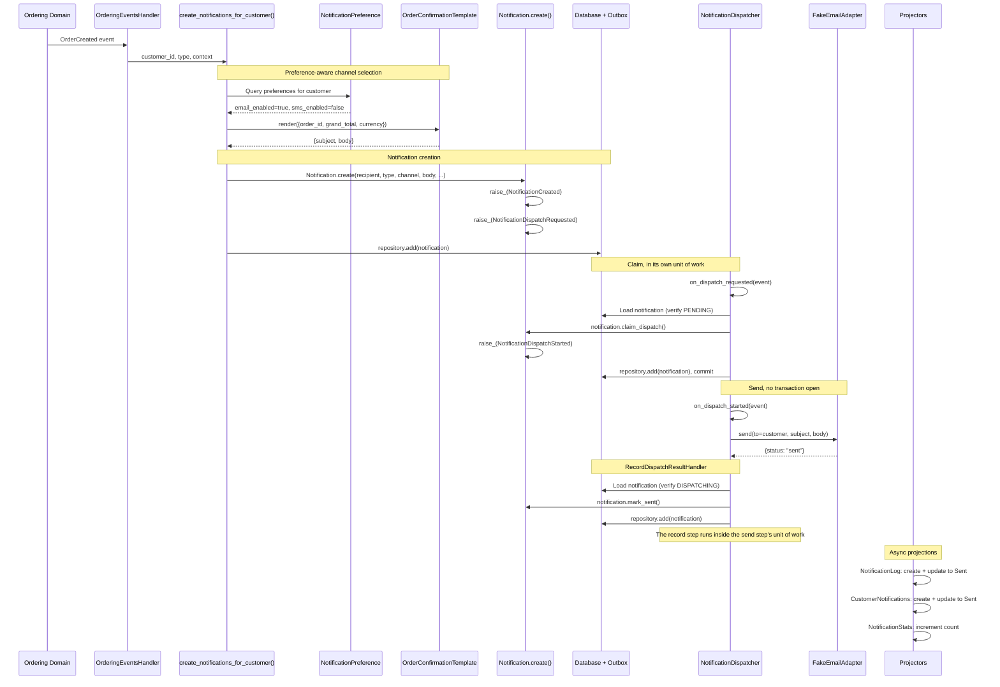

# Notification Dispatch

> A cross-domain event triggers the creation and automatic dispatch of a customer notification
> through the appropriate channel.

## The Story

Alice just placed an order on ShopStream. The Ordering domain raises an `OrderCreated`
event. The Notifications domain consumes this event and creates an order confirmation
email for Alice. Because the notification is immediate (not scheduled for the future),
the notification requests its own dispatch. The dispatcher first claims it, so it can
no longer be cancelled or sent twice, then sends it via the email adapter with no
database transaction open, and records it as Sent.

Alice receives her confirmation email within seconds.

## The Flow

### 1. Cross-Domain Event

The Ordering domain commits an order and writes an `OrderCreated` event to the outbox.
In production, the Notifications Engine picks up this event from Redis Streams.
In synchronous mode (dev/test), the event is processed inline.

The event carries: `order_id`, `customer_id`, `grand_total`, `currency`, `items`, `created_at`.

&rarr; [source](../../src/shared/events/ordering.py) (`OrderCreated`)

### 2. Event Handler

`OrderingEventsHandler.on_order_created()` receives the event and delegates to
`create_notifications_for_customer()` -- the shared helper that handles the
preference-aware, template-driven notification creation pattern.

&rarr; [source](../../src/notifications/notification/ordering_events.py)

### 3. Preference Lookup + Channel Selection

The helper performs these steps:

1. **Template lookup:** Maps `NotificationType.ORDER_CONFIRMATION` to
   `OrderConfirmationTemplate`, which declares `default_channels = [Email]`.
2. **Preference lookup:** Queries the `NotificationPreference` aggregate for Alice's
   preferences. If preferences exist, filters the template's default channels against
   Alice's enabled channels. If no preferences exist, falls back to email only (safe default).
3. **Subscription check:** If Alice has unsubscribed from `OrderConfirmation`, returns
   empty (no notifications created).
4. **Template rendering:** Calls `OrderConfirmationTemplate.render({order_id, grand_total, currency})`
   to produce `{subject, body}`.
5. **Notification creation:** Creates one `Notification` aggregate per enabled channel,
   storing the rendered content, template name, source event correlation, and context data.

&rarr; [source](../../src/notifications/notification/helpers.py) (`create_notifications_for_customer`)

### 4. Auto-Dispatch

`Notification.create()` raises `NotificationCreated`. Because the notification is not
scheduled, it also raises `NotificationDispatchRequested`, which names the notification.
`NotificationDispatcher` handles the dispatch in two steps. Each step is its own handler
method and runs in its own unit of work.

**Claim.** When the unit of work that saved the notification commits,
`on_dispatch_requested` loads the notification. If it is still `PENDING`, it calls
`claim_dispatch()`, which moves it to `DISPATCHING` and raises
`NotificationDispatchStarted`. That event carries the channel, recipient, subject, body
and retry count. If the notification is no longer `PENDING`, because it was cancelled or
an earlier request already claimed it, the handler skips it and nothing is sent.

**Send.** When the claim commits, `on_dispatch_started` reacts to `NotificationDispatchStarted`:

1. Gets the channel adapter via `get_channel(event.channel)`.
2. Calls `_dispatch_via_channel(adapter, event)`, which routes to the correct
   adapter method based on channel type (email: `send(to, subject, body)`, SMS: `send(to, body)`, etc.).
3. Processes `RecordDispatchResult`, with a `failure_reason` when the adapter
   reported a failure or raised.

The send step reaches no repository before the send. On Postgres the Unit of Work
opens its transaction at the first repository access, so no transaction or pooled
connection is held while the channel is called. The fake adapters check this on every
send.

`RecordDispatchResultHandler` then loads the notification. If it is still `DISPATCHING`,
it calls `mark_sent()` or `mark_failed(reason)` and persists it.

&rarr; [source](../../src/notifications/notification/dispatch.py)

### 5. Projection Updates

Events raised during the notification lifecycle trigger projectors:

| Event | Handled By | Effect |
|-------|-----------|--------|
| `NotificationCreated` | `NotificationLogProjector` | Creates audit trail entry with status=Pending |
| `NotificationCreated` | `CustomerNotificationsProjector` | Creates customer feed entry (skips internal notifications) |
| `NotificationDispatchStarted` | `NotificationLogProjector` | Updates status to Dispatching |
| `NotificationSent` | `NotificationLogProjector` | Updates status to Sent, records sent_at |
| `NotificationSent` | `NotificationStatsProjector` | Increments daily count for this type+channel |
| `NotificationSent` | `CustomerNotificationsProjector` | Updates status to Sent |

### 6. API Response

Since notification creation is triggered by cross-domain events (not API calls), there
is no direct HTTP response. The customer can later query their notification history via
`GET /notifications/{customer_id}` to see the confirmation email in their feed.

## Sequence Diagram

## Edge Cases

| Scenario | What Happens | Why |
|----------|-------------|-----|
| Customer has no preferences | Falls back to email-only channel | Safe default prevents missing critical notifications |
| Customer unsubscribed from OrderConfirmation | No notification created, returns empty list | Respects customer preferences |
| All channels disabled | No notification created, logs "No enabled channels" | Preference enforcement |
| Email adapter fails (SMTP error) | Notification marked FAILED, added to FailedNotifications queue | Retry logic available via `RetryNotification` command |
| Email adapter raises exception | Notification marked FAILED with exception message | Exception safety in dispatch handler |
| Dispatch request delivered twice, or requested twice (a retry and the scheduler) | Sent once: the second request finds the notification no longer PENDING and skips | Only a PENDING notification can be claimed |
| Notification cancelled before its claim | Not sent; the status stays CANCELLED | The claim skips a notification that is not PENDING |
| Cancel after the claim | Refused with a validation error; the send goes ahead | DISPATCHING → CANCELLED is not an allowed transition |
| `NotificationDispatchStarted` redelivered after a crash between the send and the record | The adapter is called again | The send reads nothing first, and the channel ports take no idempotency key |
| Version conflict when recording the result | Memory: the whole send step is retried and the adapter is called again. Postgres: the result is lost and the notification stays DISPATCHING | Protean cannot commit the record step on its own (proteanhq/protean#1915, proteanhq/protean#1914) |
| Send step never records a result (for example, dead-lettered) | After 15 minutes `ExpireStaleDispatches` marks it FAILED with "No dispatch result recorded; outcome unknown"; it is not sent again until retried | The send may already have reached the recipient |
| Notification not found when recording the result | Handler logs an error and returns | Safety for eventual consistency |
| Scheduled notification (e.g., review prompt) | No dispatch request at creation; stays PENDING | `ProcessScheduledNotifications` requests dispatch once it is due |
| Failed notification retried | `RetryNotification` sets it PENDING and requests dispatch again, for scheduled and immediate notifications alike | A retried scheduled notification is claimed once, whichever request comes first |
