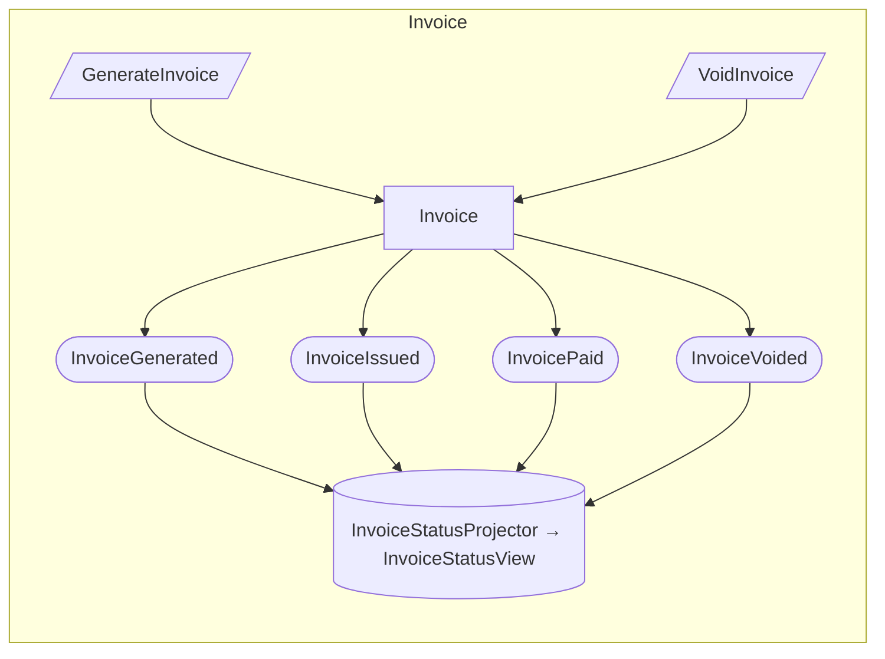

## Event Model: Invoice

> **Given** Invoice
> **When** GenerateInvoice, VoidInvoice
> **Then** InvoiceGenerated, InvoiceIssued, InvoicePaid, InvoiceVoided

## Event Model: Payment

> **Given** Payment
> **When** InitiatePayment, ProcessRefundWebhook, RequestRefund, RetryPayment, ProcessPaymentWebhook
> **Then** PaymentFailed, PaymentInitiated, PaymentProcessing, PaymentRetryInitiated, PaymentSucceeded, RefundCompleted, RefundRequested

```mermaid
flowchart LR
    subgraph payments_payment_payment_Payment[Payment]
        cmd_payments_payment_initiation_InitiatePayment[/InitiatePayment/]
        cmd_payments_payment_refund_ProcessRefundWebhook[/ProcessRefundWebhook/]
        cmd_payments_payment_refund_RequestRefund[/RequestRefund/]
        cmd_payments_payment_retry_RetryPayment[/RetryPayment/]
        cmd_payments_payment_webhook_ProcessPaymentWebhook[/ProcessPaymentWebhook/]
        agg_payments_payment_payment_Payment[Payment]
        evt_payments_payment_events_PaymentFailed([PaymentFailed])
        evt_payments_payment_events_PaymentInitiated([PaymentInitiated])
        evt_payments_payment_events_PaymentProcessing([PaymentProcessing])
        evt_payments_payment_events_PaymentRetryInitiated([PaymentRetryInitiated])
        evt_payments_payment_events_PaymentSucceeded([PaymentSucceeded])
        evt_payments_payment_events_RefundCompleted([RefundCompleted])
        evt_payments_payment_events_RefundRequested([RefundRequested])
        rm_payments_payment_payment_Payment_payments_projections_customer_payments_CustomerPaymentProjector[(CustomerPaymentProjector → CustomerPayment)]
        rm_payments_payment_payment_Payment_payments_projections_daily_revenue_DailyRevenueProjector[(DailyRevenueProjector → DailyRevenue)]
        rm_payments_payment_payment_Payment_payments_projections_failed_payments_FailedPaymentProjector[(FailedPaymentProjector → FailedPayment)]
        rm_payments_payment_payment_Payment_payments_projections_payment_status_PaymentStatusProjector[(PaymentStatusProjector → PaymentStatusView)]
        rm_payments_payment_payment_Payment_payments_projections_refund_report_RefundReportProjector[(RefundReportProjector → RefundReport)]
    end
    cmd_payments_payment_initiation_InitiatePayment --> agg_payments_payment_payment_Payment
    cmd_payments_payment_refund_ProcessRefundWebhook --> agg_payments_payment_payment_Payment
    cmd_payments_payment_refund_RequestRefund --> agg_payments_payment_payment_Payment
    cmd_payments_payment_retry_RetryPayment --> agg_payments_payment_payment_Payment
    cmd_payments_payment_webhook_ProcessPaymentWebhook --> agg_payments_payment_payment_Payment
    agg_payments_payment_payment_Payment --> evt_payments_payment_events_PaymentFailed
    evt_payments_payment_events_PaymentFailed --> rm_payments_payment_payment_Payment_payments_projections_customer_payments_CustomerPaymentProjector
    evt_payments_payment_events_PaymentFailed --> rm_payments_payment_payment_Payment_payments_projections_failed_payments_FailedPaymentProjector
    evt_payments_payment_events_PaymentFailed --> rm_payments_payment_payment_Payment_payments_projections_payment_status_PaymentStatusProjector
    agg_payments_payment_payment_Payment --> evt_payments_payment_events_PaymentInitiated
    evt_payments_payment_events_PaymentInitiated --> rm_payments_payment_payment_Payment_payments_projections_customer_payments_CustomerPaymentProjector
    evt_payments_payment_events_PaymentInitiated --> rm_payments_payment_payment_Payment_payments_projections_payment_status_PaymentStatusProjector
    agg_payments_payment_payment_Payment --> evt_payments_payment_events_PaymentProcessing
    evt_payments_payment_events_PaymentProcessing --> rm_payments_payment_payment_Payment_payments_projections_payment_status_PaymentStatusProjector
    agg_payments_payment_payment_Payment --> evt_payments_payment_events_PaymentRetryInitiated
    evt_payments_payment_events_PaymentRetryInitiated --> rm_payments_payment_payment_Payment_payments_projections_failed_payments_FailedPaymentProjector
    evt_payments_payment_events_PaymentRetryInitiated --> rm_payments_payment_payment_Payment_payments_projections_payment_status_PaymentStatusProjector
    agg_payments_payment_payment_Payment --> evt_payments_payment_events_PaymentSucceeded
    evt_payments_payment_events_PaymentSucceeded --> rm_payments_payment_payment_Payment_payments_projections_customer_payments_CustomerPaymentProjector
    evt_payments_payment_events_PaymentSucceeded --> rm_payments_payment_payment_Payment_payments_projections_daily_revenue_DailyRevenueProjector
    evt_payments_payment_events_PaymentSucceeded --> rm_payments_payment_payment_Payment_payments_projections_failed_payments_FailedPaymentProjector
    evt_payments_payment_events_PaymentSucceeded --> rm_payments_payment_payment_Payment_payments_projections_payment_status_PaymentStatusProjector
    agg_payments_payment_payment_Payment --> evt_payments_payment_events_RefundCompleted
    evt_payments_payment_events_RefundCompleted --> rm_payments_payment_payment_Payment_payments_projections_customer_payments_CustomerPaymentProjector
    evt_payments_payment_events_RefundCompleted --> rm_payments_payment_payment_Payment_payments_projections_daily_revenue_DailyRevenueProjector
    evt_payments_payment_events_RefundCompleted --> rm_payments_payment_payment_Payment_payments_projections_payment_status_PaymentStatusProjector
    evt_payments_payment_events_RefundCompleted --> rm_payments_payment_payment_Payment_payments_projections_refund_report_RefundReportProjector
    agg_payments_payment_payment_Payment --> evt_payments_payment_events_RefundRequested
    evt_payments_payment_events_RefundRequested --> rm_payments_payment_payment_Payment_payments_projections_payment_status_PaymentStatusProjector
    evt_payments_payment_events_RefundRequested --> rm_payments_payment_payment_Payment_payments_projections_refund_report_RefundReportProjector
```

